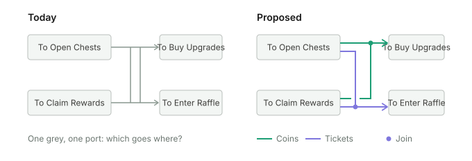

# Pipe legibility: every pipe identifiable at first glance

Status: first release built on `feat/pipe-legibility`, 14 Nov 2026 (see "Built in the first release"). Row ports, stubs and trunks are not built. Decision owner: Phillip. Implementer: [x].

## Overview

- Pipes in an Economy Flow diagram carry no identity. Every pipe is the same thin grey line from the same port, so a reader has to trace each wire by eye to learn what it connects.
- The proposal gives each pipe an identity first (the resource it carries, shown as a colour and a tag) and changes the geometry second (ports, joins, crossings, long hauls).
- The router is in better shape than the picture suggests: pipes already run in separate lanes and already hop at crossings. The work is mostly in what a pipe looks like and what it knows.

## Proposed changes

Five changes. The build order is in the table further down.

### 1. Pipe identity

- Add an optional `resource` field to a pipe.
- Colour the pipe by resource and draw a small tag with the resource name at the target end.
- List the resources in the legend.
- A pipe with no resource stays grey and is listed in the layout issues.
- Existing documents: fill the field only when exactly one row name matches at both ends. Otherwise leave it empty.

### 2. Row ports

- A pipe with a resource leaves from the `+` or `=` row for that resource on the source card and lands on the matching `-` or `=` row on the target.
- With no resource or no matching row, the pipe uses the title bar, as today.
- Roots and final goods keep the title-bar port.

### 3. Join and crossing grammar

- A dot wherever pipes merge.
- Pipes carrying the same resource into the same card merge into one trunk on purpose, with the arrowhead on the trunk.
- Pipes carrying different resources never share a segment.
- At a crossing, the lower line breaks with a gap. This replaces the 7 px hop.

### 4. Stubs for long hauls

- A pipe that leaves its group is drawn as a short stub with a destination tag at the source (`-> To Upgrade Gear`) and an origin tag at the target.
- Hover or selection draws the full wire.
- A "show all wires" toggle keeps the complete view.

### 5. Focus

- Hover or select a card, a pipe or a legend resource: its pipes stay at full strength and the rest dim.
- Add "export focused view" so the focus state reaches the PNG.

### Smaller items

- A heavier pipe stroke.
- A crossings count in the layout issues, so authors can reorder cards. No automatic reordering in this version.

## Proposed starting values

These are starting proposals. None is an agreed setting.

| Item | Proposal |
| --- | --- |
| Resource palette | 8 colours, none reusing the row-sign colours (green `+`, red `-`, orange `=`). A ninth resource and beyond stay grey with a tag |
| Junction dot | Radius 3 px |
| Crossing gap | 10 px |
| Lane spacing | Lanes carrying different resources at least 24 px apart (12 px today) |
| Forward pipe stroke | 2 px (1.5 px today) |
| Stub rule | Any pipe that leaves its group: 10 of 24 forward pipes in the sample. Narrower option: leaves its group and spans two or more stages, 3 of 24 |
| Unfocused pipes | 15% opacity |
| PNG default | Stubs on |

## Build order and size

| Order | Step | Where | Size |
| --- | --- | --- | --- |
| 1 | Pipe identity (step 1) and join and crossing grammar (step 3) | `edgeSchema` in `document.ts`; `pipeColor`, `PipeDrawing`, `BridgeDrawing` and the legend in `DiagramSvg.tsx`; `tracksConflict` and `crossingBridges` in `layout.ts` | Small to medium |
| 2 | Run the trace test below | | |
| 3 | Focus (step 5) | `Canvas.tsx`, `styles.css`, `svgBlob` in `lib/export.tsx` | Medium |
| 4 | Stubs (step 4), then row ports (step 2) | The router and `port()` in `layout.ts` | Large. Build only if the trace test is still under target |

## Measurement

Trace test, on the PNG at 1,280 px wide with no zoom:

- A reviewer who has not seen the diagram is shown 5 randomly chosen pipes, each marked mid-run, and names the source and target card of each.
- Score: correct answers out of 5, from at least two reviewers.
- Record today's score before any change. Proposed target: 4 of 5.

Mechanical checks, on the sample diagram and the bundled examples:

- Every pipe with a resource is coloured and tagged.
- Every merge has a dot.
- No two pipes carrying different resources sit closer than the minimum lane spacing.
- The canvas and the PNG match.
- The existing layout tests pass.

Decision rule:

- Target reached after steps 1 and 3: ship them, then add focus. Stubs and row ports stay parked.
- Target missed: build stubs, test again, then row ports.
- Redesign the colour approach if diagrams in the library routinely carry more than 8 resources.

## Scope

| In | Out |
| --- | --- |
| Pipe schema, pipe drawing, ports, router | Card content and titles |
| Hover and selection, legend | Stage and group layout |
| PNG and SVG export | Automatic card reordering |
| The MCP validate and create tools that accept documents | The legacy FigJam plugin and the pilot research app |

## Launch checks

- Pipe labels and `trace.ts` landed before this work (commits `0a187d2` and `8ca2d03`); the first release builds on them.
- Count resources per diagram across the existing library before fixing the palette size.
- A document without the `resource` field renders exactly as it does today.
- Rule GEC-008 in `docs/ECONOMY_FLOW_RULES.md` says the full view contains every accepted relationship and that focused views are not substitutes for the full connected diagram. The all-wires view stays the contract view; stubs and focus are display modes on top of it.

## Decisions needed

- The palette, and whether colour means resource (proposed) or source group.
- Whether stubs are the default in the PNG.
- Whether a stub pair satisfies GEC-008 as written, or the rule's wording changes.
- Whether existing documents are filled in automatically or the editor asks.
- Whether the MCP tools require `resource` on new pipes.

## What the renderer did before the first release

Read from the code at commit `8ca2d03` on 14 Nov 2026 and measured on one recent sample diagram (18 cards, 25 pipes, 7 resources).

| Area | Before |
| --- | --- |
| Lanes | Each pipe gets its own lane, 12 px apart (`TRACK = 12` in `web/src/core/layout.ts`). Shared segments are rejected, except terminal stubs into the same endpoint (`tracksConflict`). Pipes do not overlap |
| Crossings | A hop arc 8 px wide and 7 px high, on horizontal segments only (`crossingBridges`, `bridgePath`, `BridgeDrawing`) |
| Colour and weight | Every forward pipe is grey `#89978f` at 1.5 px (`pipeColor`, `PipeDrawing` in `web/src/components/DiagramSvg.tsx`). Final pipes are dashed; value pipes use the value colour |
| Ports | One port per card side, at the middle of the title bar (`port()` in `layout.ts`). One card in the sample receives 5 pipes at a single point |
| Merges | Later pipes into the same target lose their arrowhead. There is no junction dot |
| Labels | All 25 pipes have a `label` in the document. Labels are drawn only when `settings.showLabels` is on (off by default and in every preset): `placeLabel` puts each on the longest straight run of its route |
| Resource | A pipe records `id`, `from`, `to`, `type`, `feedback` and `label`. Row names match at both ends for 10 of 25 pipes, and on exactly one resource for 9, so name matching cannot fill the field on its own |
| Long hauls | 10 of 24 forward pipes leave their group; 8 span two or more stage columns |
| Focus | Hover or selection of a card draws its upstream investment path in gold (`#b08716`, 2.4 px, `traceInvestments` in `web/src/core/trace.ts`); selecting a pipe turns it gold. Nothing else dims. `svgBlob` in `web/src/lib/export.tsx` receives only a card selection, so no focus state reaches the PNG |
| Export scale | The PNG exports at 2x. At 5,056 px wide viewed at 1,280 px, a 1.5 px pipe renders under 1 px and two lanes sit 6 px apart |
| Card order | Fixed by `card.order` in the document. Nothing reduces crossings |

## Built in the first release

Steps 1, 3 (drawing only) and 5. The router is unchanged: `route.points` are byte-identical to the previous build for every example and preset at compact, comfortable and slide spacing, with resources on and off.

| Area | Built |
| --- | --- |
| Pipe field | Optional `resource` (up to 160 characters, default empty) on `edgeSchema` and the v2 import schema. It round-trips through import, `applyEdits` and the MCP tools, whose descriptions mention it |
| Inference | `web/src/core/pipeResource.ts`: the field when set, else the one resource on the source's `+` and `=` rows that matches a `-` or `=` row on the target. Several matches infer nothing. The sample infers 9 of 25 pipes |
| Colour | 8 colours (`RESOURCE_PALETTE`): blue, magenta, teal, violet, brown, navy, pink, charcoal. Assigned in order of first appearance on a card. The ninth resource and beyond, and pipes with no resource, stay grey. A resource colour wins over the value colour; final pipes keep their dash |
| Tag | A 10 px pill with the resource name, white with a 1 px border in the pipe colour, on a run that belongs to that pipe alone, as near the target as it fits: horizontal runs first, then vertical tracks (rotated), then the source stub. It never covers a card, a group heading, a pipe label, another tag or another pipe. No clear spot, no tag. Placed in `layout.ts` (`placeTags`) so canvas and export agree. The sample tags all 9 resourced pipes |
| Key | The export key lists each coloured resource after the row-sign entries, wrapping only when the line is full. The canvas shows the same list as a clickable key |
| Setting | `settings.showResources`, default on, in Appearance as "Colour and tag pipes by resource". Off restores grey, untagged pipes and the old key |
| Joins | A dot (radius 3) in the pipe colour where a later pipe joins a run already drawn into the same card. `pipeEnds` in `layout.ts` decides arrowheads and dots for the layout and for selection exports |
| Crossings | The horizontal pipe breaks with a gap about 10 px wide (12 px path gap with round caps) where a vertical pipe passes through; gaps for neighbouring lanes merge into one break. `route.bridges` and `BridgeDrawing` are gone; `route.gaps` lists the break points |
| Weight | Forward pipes 2 px, return pipes 1.5 px, selected pipe 2.8 px |
| Focus | Hovering or selecting a card, selecting a pipe, or clicking a resource in the canvas key keeps those pipes at full strength in their own colour and drops the rest to 15% opacity; cards off the path dim to 45%. A selected pipe without a resource colour still turns gold. A focused pipe whose card's first pipe is dimmed gets its own arrowhead (`withEnds`). 120 ms opacity transition, no layout shift. Escape or a second click clears the resource focus |
| Export | `svgBlob`, `pngBlob`, `copyPng` and `DiagramSvg` take an optional focus (`{ cards, edges }`). Share shows "Export focused view" when a resource or selection focus exists; the default PNG button is unchanged |

Deferred:

- Row ports (step 2).
- Stubs for long hauls (step 4) and the "show all wires" toggle.
- Trunk merging of same-resource pipes into one card, and wider lane spacing between different resources (step 3, router side).
- Listing pipes with no resource in the layout issues.
- A crossings count in the layout issues.
- The trace test and the palette decision with the decision owner. On a test render the weakest pair is navy and charcoal on the pale group fills; brown is the closest to the sink red.
